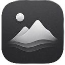
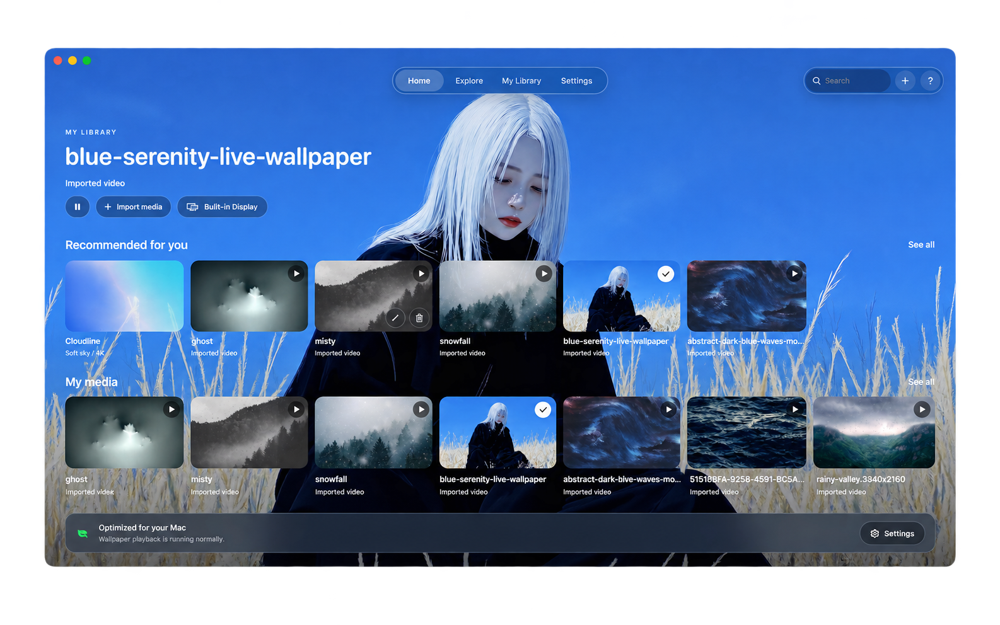

# Lumen

<p align="center">
  
</p>

<p align="center">
  A native macOS app for living desktop wallpapers, built with SwiftUI.
</p>

<p align="center">
  
  <a href="LICENSE"></a>
  
</p>



## Why Lumen

Lumen keeps your desktop calm and alive without subscriptions, accounts, or a cloud library. Pick a built-in procedural scene, import your own media, and send it to one display or all of them.

## Features

- **Procedural wallpaper** rendered natively with SwiftUI `Canvas` and `TimelineView`.
- **Local media library** for `.mov`, `.mp4`, `.m4v`, `.avi`, `.jpg`, `.jpeg`, `.png`, and `.heic`.
- **Smooth looping video** with muted playback and a 24 FPS procedural budget.
- **Display targeting** for the built-in display, external displays, or all displays.
- **Discover** random and searchable Wallhaven images plus Pexels videos, with one-click download and activation as the current wallpaper.
- **Dedicated settings** for playback, battery quality, CPU/full-screen pausing, and Retina rendering.
- **Optional NSFW image search** for Wallhaven, protected behind an explicit Settings toggle and API key.
- **Sleep-aware playback** that pauses and hides wallpaper windows while macOS or its displays are asleep.
- **Menu bar controls** for quick pause/resume, Settings, and app access.
- **Video Wallpaper** registered in macOS **System Settings > Wallpaper**, for both the desktop and idle/lock screen.
- **Offline-first by design**: imported media stays in `~/Library/Application Support/LumenWallpapers/Library`.
- **Wallpaper persistence** after quitting: images stay as the macOS desktop image, while live scenes can keep animating in a background helper.
- **Update notifications** from GitHub, shown once per newer stable release, plus a repository link in Settings.

## Install

### Download a release

1. Open the [Releases](../../releases) page.
2. Download the latest `Lumen-<version>.dmg`.
3. Open the DMG and drag **Lumen** to **Applications**.
4. Launch the app from Applications.

Release DMGs built with the included script are universal (`arm64` + `x86_64`). Unsigned builds may show a Gatekeeper warning; see [Release signing](#release-signing) for a trusted distribution build.

For a trusted local or ad-hoc build, Control-click **Lumen.app**, choose **Open**, and confirm. If macOS still blocks it after the first launch attempt, open **System Settings > Privacy & Security > Open Anyway**. Only bypass Gatekeeper for artifacts you built yourself or obtained from a source you trust.

### Build from source

Requirements:

- macOS 14 Sonoma or newer
- Xcode 16 or newer

The Xcode project is the canonical build entry point:

```sh
cd LumenWallpapers
xcodebuild -project LumenWallpapers.xcodeproj \
  -scheme LumenWallpapers \
  -configuration Release \
  -destination 'platform=macOS' \
  CODE_SIGNING_ALLOWED=NO build
```

For a quick command-line smoke build:

```sh
swift build
```

## Use your own wallpapers

Click `+` in the top bar or **Import media** in the preview. Lumen copies selected files into its private library, so moving the originals later will not break your collection. Rename or remove imported items from their card controls.

For smooth loops, use a 16:9 or 16:10 clip at 1080p or 4K, around 10–30 seconds long, with matching first and last frames. Wallpaper audio is muted by design.

**Video Wallpaper** uses the selected video on the signed-in lock screen on supported macOS versions. Turn it off in Settings to use a still preview. Procedural scenes and systems without native video support use still previews.

The **Discover** tab can browse Wallhaven images and, when a Pexels API key is configured, Pexels videos. Downloading a card adds it to **My Library**, immediately applies it as the wallpaper, and leaves the card clickable for switching back to it later. Hover over a downloaded card to remove it from the library. The Home recommendations row is populated from shuffled API results when they are available.

The Settings tab also includes battery-aware quality reduction, automatic pause for full-screen apps or sustained CPU load, Retina rendering, and launch-at-login. These preferences are stored locally. When the Mac or its displays sleep, Lumen pauses playback and hides its wallpaper windows while keeping the renderers available for a smooth resume after wake.

When you quit Lumen, it saves the selected wallpaper as the macOS desktop image. For a playing video or procedural wallpaper, the **Keep Animating After Quit** setting also starts a small background helper so the scene keeps moving. Reopening Lumen stops the helper and returns rendering to the app. Turn the setting off if you prefer a still image after quitting. Enable **Launch at Login** if you also want Lumen to resume live wallpaper after signing in again.

Only import media you created yourself or have permission to use. Good sources for openly licensed material include [Pexels](https://www.pexels.com/), [Pixabay](https://pixabay.com/), [Mixkit](https://mixkit.co/), [NASA media](https://images.nasa.gov/), and [Wikimedia Commons](https://commons.wikimedia.org/).

## Release signing

[`scripts/build-release.sh`](scripts/build-release.sh) builds a universal app and DMG in `build/releases/<version>/` and removes its build caches after verification. Failed builds retain their diagnostics. With no signing variables it produces a local, ad-hoc build. For distribution, use a paid Apple Developer account and set:

```sh
export DEVELOPER_ID_APPLICATION="Developer ID Application: Your Name (TEAMID)"
export KEYCHAIN_PROFILE="lumen-notary"
./scripts/build-release.sh 0.1.9
```

Create the `notarytool` keychain profile once with `xcrun notarytool store-credentials`. The script signs with hardened runtime, submits the DMG for notarization, and staples the ticket. A notarized, Developer ID-signed DMG is what gives users the normal “open” experience without an unidentified-developer warning.

## macOS limitation

macOS controls the lock screen and login screen. Native video wallpaper depends on macOS's Aerials integration and applies to the signed-in lock screen; Lumen does not change the login screen shown before signing in.

## Privacy

Lumen does not include analytics, advertising, accounts, or tracking SDKs. Discover connects directly to Wallhaven and Pexels when loading remote results; see [PRIVACY.md](PRIVACY.md) for the data-handling summary.

## Contributing

Bug reports, feature ideas, and pull requests are welcome. Please read [CONTRIBUTING.md](CONTRIBUTING.md) first.

## License

Lumen is available under the [MIT License](LICENSE).
